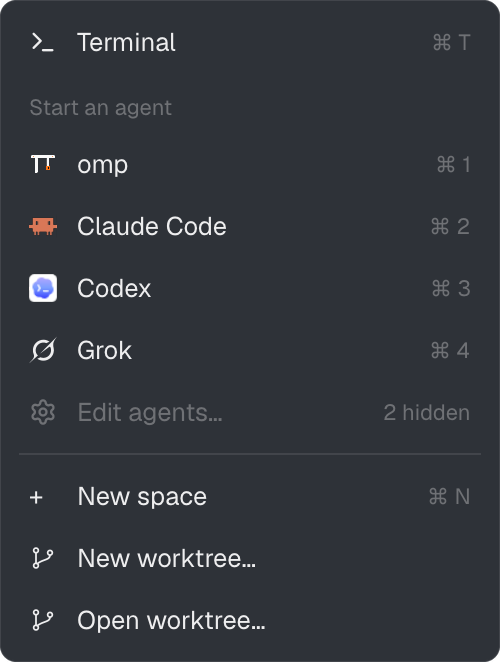
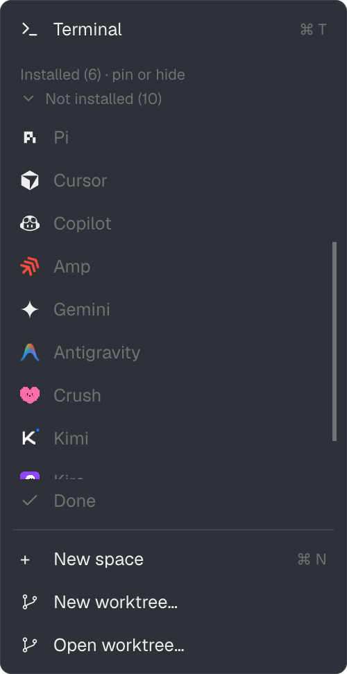

# Agent Menu

**Herdr's + menu, with an agent list you choose.** Pin the agents you use most to the top, hide the ones you never start, and stop scrolling past agents this machine doesn't have.

A mod for the [Herdr](https://herdr.dev) desktop app. It replaces the shipped `new-menu` popup that opens from the tab bar's **+** button.

<table>
  <tr>
    <td align="center"></td>
    <td align="center"></td>
    <td align="center"></td>
  </tr>
  <tr>
    <td align="center"><sub>The menu: your agents, numbered</sub></td>
    <td align="center"><sub>Edit agents…: pin or hide</sub></td>
    <td align="center"><sub>What else Herdr knows, folded away</sub></td>
  </tr>
</table>

## Why

Herdr's own + menu lists every installed agent plus two it suggests installing, most-used first, and you can't change that. Agent Menu shows only the agents you want:

- **Only installed agents.** Agents that aren't on this machine never show in the menu.
- **Pin** agents to the top, in the order you pinned them.
- **Hide** agents you never start. "Edit agents…" shows how many are hidden.
- **Numbers that follow your list.** The first nine rows get `⌘1`–`⌘9` (`Ctrl` off macOS). Hide the second agent and the third becomes `⌘2`.
- **Edit in place.** "Edit agents…" turns the menu into its own editor. No settings file to edit.
- **Saved everywhere.** Pins and hidden agents apply to every window and survive restarts.
- **Scrolls past nine.** With more agents, the list scrolls and Terminal, Edit agents and New space stay put.

Everything else matches the shipped menu: Terminal, New space, New worktree…, Open worktree…, `⌘T` and `⌘N`.

## Use

| Action | Result |
| --- | --- |
| Click an agent, or `⌘1`–`⌘9` | Starts it in a new tab and closes the menu |
| `⌘T` / `⌘N` | New terminal tab / new space |
| **Edit agents…** | Switches to edit mode; the menu stays open |
| Pin button | Pins or unpins. Pinned agents come first |
| Eye button | Hides or shows the agent in the menu |
| **› Not installed** | Unfolds the agents Herdr knows but this machine doesn't have (read-only) |
| **Done** | Back to the menu |

Installed agents are checked on the machine of the active space, so a remote space can list different agents. Pins and hidden agents apply on every machine.

## Install

### Ask your Herdr agent

In a Herdr terminal, ask your agent:

> Add the mod from https://github.com/amster93/herdr-agent-menu and make the tab bar's + button open it.

Herdr's agent instructions cover adding mods from GitHub. The agent reads [RECIPE.md](RECIPE.md), which also explains how to rewire the + button.

### By hand

Paths below use the default Herdr home, `~/.config/herdr-app`.

1. Copy the mod:

   ```sh
   git clone https://github.com/amster93/herdr-agent-menu
   cp -R herdr-agent-menu/mods/agent-menu ~/.config/herdr-app/mods/
   ```

2. Clone the shipped tab bar. Never edit `tabs` itself: Herdr restores shipped mods on the next start.

   ```sh
   herdr-app do mod.clone '{"name":"tabs","as":"tabs-plus"}'
   ```

   In `~/.config/herdr-app/mods/tabs-plus/main.js`, find the + button and change `mod: "new-menu"` to `mod: "agent-menu"`:

   ```js
   .child(button("tab-new", "+", () => openOverlay({ mod: "agent-menu", kind: "popup", width: 250, height: 512 })))
   ```

3. Use the cloned tab bar in your layout. If you're on a shipped layout, clone it first (this also switches to the clone):

   ```sh
   herdr-app do layout.clone '{"name":"main","as":"main-plus"}'
   ```

   In `~/.config/herdr-app/layouts/main-plus.json`, change the tabs block's `"mod": "tabs"` to `"mod": "tabs-plus"`. Herdr reloads the layout as soon as you save.

4. Check it:

   ```sh
   herdr-app check ~/.config/herdr-app/mods/agent-menu
   ```

Clones are never updated, so your changes survive Herdr updates. To go back, switch to your old layout (`ctrl-shift-l`) and delete the `agent-menu` folder.

If your home already has a mod called `agent-menu`, rename the folder. Then change the `DIR` constant at the top of `main.js` and the `mod:` name in `tabs-plus` to the new name.

## What it touches

- **No network, no `exec`, no `hc`.**
- Reads only its own folder, plus Herdr's shipped `icons/shell.svg` and `mods/workspace-chrome/branch.svg`.
- Stores two arrays of agent keys in Herdr's shared state (`shared.json`): `agentMenu.pinned` and `agentMenu.hidden`.
- Uses Herdr's own `knownAgents()` to find agents, so overrides and extra agents in your `programs.json` show up too.

## Build it yourself

[RECIPE.md](RECIPE.md) is the full brief: what you see, how it behaves, what it's built from and what to watch out for. It has enough detail for an agent to rebuild the mod from an empty folder, for example on a Herdr version where these files no longer work.

## License

Code: Apache-2.0, see [LICENSE](LICENSE). Built from Herdr's shipped `new-menu` mod. Icons: [Lucide](https://lucide.dev), ISC, see [LICENSE-Lucide.txt](LICENSE-Lucide.txt).
