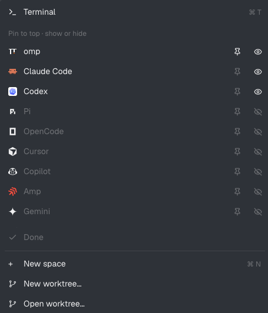

# New menu plus

The tab bar's **+** menu (Terminal, Start an agent, New space, worktrees), with
the agent list under your control: pin the agents you use to the top, hide the
ones you never start. "Edit agents…" at the bottom of the list switches the
menu into an edit mode where every known agent has a pin and an eye button.
The choice persists across windows and restarts.

## What you see

A popup, 250 px wide, background `theme().popover`, 5 px padding, text 12.8 px,
rows 31 px high with 7 px rounded hover (`theme().selected`), 10 px gap
between icon (14 px) and label, a dim 11 px hint on the right.

Top to bottom:

1. **Terminal** row, `icons/shell.svg`, hint `⌘ T` (`Ctrl T` off macOS).
2. Section label, 11 px dim: "Start an agent" (edit mode: "Pin to top · show or hide").
3. **Agent list**, scrollable:
   - Normal mode: installed, not hidden agents (pinned first, in pin order, then
     Herdr's order), hint `⌘ 1` … `⌘ 9`; then up to two not-installed, not hidden
     agents, dimmed, hint "not installed", not clickable.
   - Edit mode: every known agent in the same order. Hidden ones are dimmed.
     Right side: a 22 px pin button (`pin.svg`, foreground when pinned, dim
     when not) and a 22 px eye button (`eye.svg` shown / `eye-off.svg` hidden).
   - Agent icons: `svg(icon)` tinted with the foreground when the program is
     `tint`, else `image(icon)`.
4. **Edit agents…** row, dim, `settings.svg`; hint "N hidden" when anything is
   hidden. In edit mode it reads **Done** with `check.svg`.
5. 1 px divider (`theme().border`).
6. **New space** (`+`, hint `⌘ N`), **New worktree…**, **Open worktree…**
   (`mods/workspace-chrome/branch.svg`, disabled without an active space).

Height: `min(491, 198 + max(1, rows) * 31)` px.

## How it behaves

- Clicking an agent row closes the popup and runs `tab.new {name, space, argv: agent.run}`.
- `⌘/Ctrl 1–9` start the n-th visible installed agent; `⌘/Ctrl T` opens a
  terminal; `⌘/Ctrl N` a new space. Hidden agents don't take a number, so the
  numbers follow what you see.
- "Edit agents…" toggles edit mode without closing the popup. In edit mode the
  rows themselves don't click; only the pin and eye buttons do, each toggles
  its key in a shared list and every open copy re-renders.
- Pinning appends to the pin list: the first agent pinned is the first row.
  Unpinning removes it.
- While the agent list loads: "Checking installed agents…"; on failure "Could not load agents".

## Built from

- One overlay mod, `mods/new-menu-plus/` with `main.js`, `mod.json`
  (`{ "place": "none" }`) and five Lucide glyphs (ISC): `pin`, `eye`,
  `eye-off`, `check`, `settings`. A `DIR` constant holds the folder for its icon paths.
- `herdr`: `knownAgents({ on: activeSpace.machine })` (once in `init`, in `cx.spawn`),
  `shared` / `setShared` with keys `newMenu.hidden` and `newMenu.pinned` (arrays of
  agent keys), `run("tab.new" | "space.new")`, `openOverlay` for the shipped
  `worktree` dialog (`{action: "new"}` 460×280, `{action: "open"}` 560×480),
  `closeOverlay(props().overlay)`, `spaces()`, `panes()`, `window().platform`, `theme()`.
- Started from the shipped `new-menu` mod; it replaces it.
- No network, no `exec`/`hc`, no files outside its folder besides the shipped
  `icons/shell.svg` and `mods/workspace-chrome/branch.svg`.

## Watch out

- The **+** button belongs to the shipped `tabs` mod:
  `openOverlay({ mod: "new-menu", kind: "popup", width: 250, height: 512 })`.
  Installed under its own name, this mod only shows once that call (or your
  layout's own tab bar) opens `new-menu-plus` instead.
- Read the pin and hide lists in `render()`, not `init()`: `setShared` re-renders
  every mod, and that is what refreshes the open popup.
- Edit-mode rows carry no `on_click` of their own, so the pin and eye buttons
  are the only click targets and a click never also triggers the row.
- `shared()` values are untyped: filter to strings before using them.
- `knownAgents` is cached for up to a minute per machine; a freshly installed
  agent appears after that.

## Done when

- Opening the + menu lists installed agents with `⌘ 1…` hints and up to two "not installed" ones.
- Edit agents… → eye on an agent → Done: the agent is gone from the list and the
  hint shows "1 hidden"; its number went to the next agent.
- Pin an agent in edit mode: after Done it is the first agent row and starts with `⌘ 1`.
- Closing and reopening the window keeps pins and hidden agents.
- `herdr-app check mods/new-menu-plus` passes.
